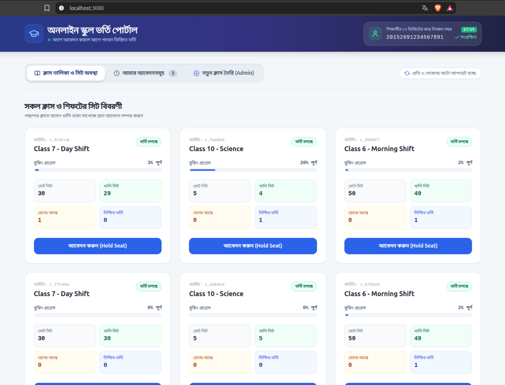
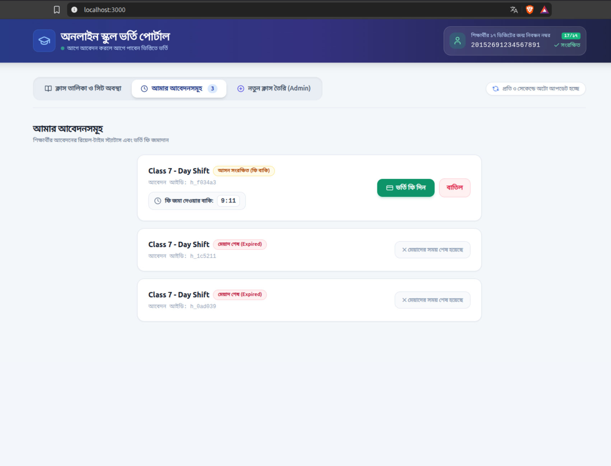
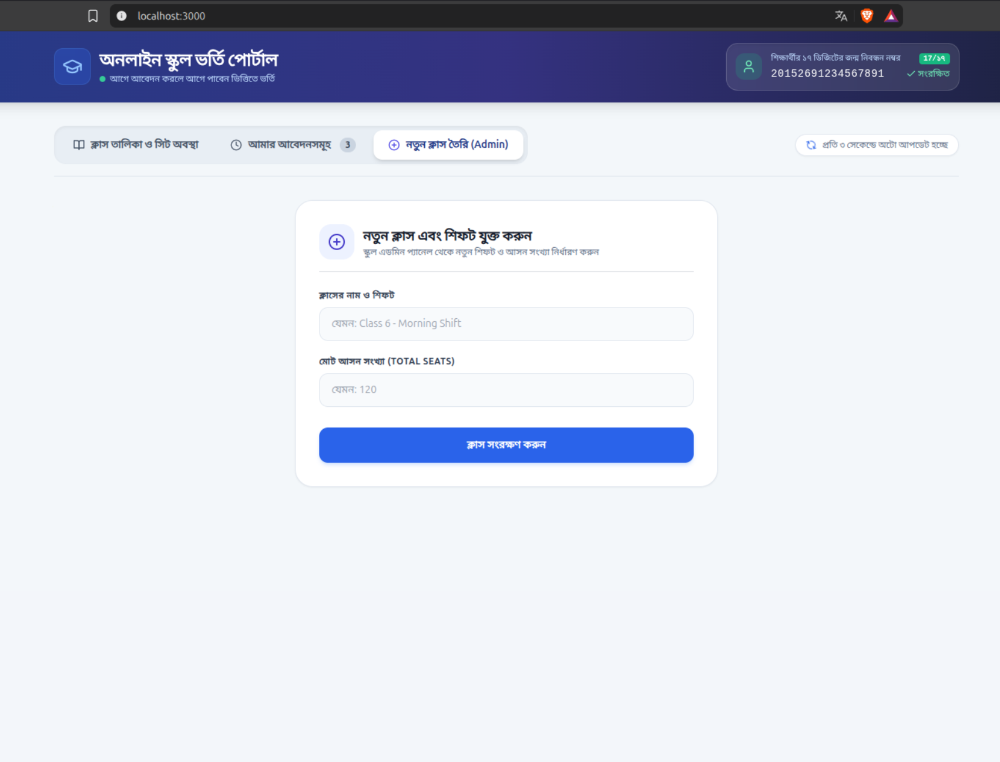

# School Admission System

An online admission system built for schools operating on a strict "first-come, first-served" policy with zero lottery. The system manages temporary seat holds, prevents seat overselling during high-concurrency traffic spikes, handles automatic seat releases when holds expire, and provides an interactive React UI.

Built for the **Assistant Software Engineer Recruitment** assessment at **Onnorokom Projukti Limited**.

---

## 📸 Screenshots & UI Preview

### 1. Class List & Real-time Seat Availability
Live dashboard showing real-time seat statistics (Total, Available, Held, Confirmed), 3-second auto-polling, and the 17-digit student birth registration input at the top.



---

### 2. My Applications & Live Expiration Countdown
Shows the applicant's active hold, a live countdown timer until expiration, the "ভর্তি ফি দিন" (Confirm Admission) button, and the "বাতিল" (Cancel) button.



---

### 3. School Admin - Class & Shift Creation
Admin panel to define class names, shifts, and total seat capacities.



---


## Tech Stack

- **Backend:** C# (.NET 8 Web API), Entity Framework Core, Npgsql
- **Database:** PostgreSQL 16
- **Frontend:** React 18, Vite, Tailwind CSS, Lucide Icons
- **Containerization:** Docker & Docker Compose

---

## Project Structure

```text
school-admission-system/
├── backend/
│   ├── SchoolAdmission.Api/
│   │   ├── Controllers/
│   │   │   ├── ClassesController.cs
│   │   │   ├── HoldsController.cs
│   │   │   └── MeController.cs
│   │   ├── Data/
│   │   │   └── AppDbContext.cs
│   │   ├── DTOs/
│   │   │   └── Contracts.cs
│   │   ├── Middleware/
│   │   │   └── GlobalExceptionMiddleware.cs
│   │   ├── Models/
│   │   │   ├── ClassEntity.cs
│   │   │   └── HoldEntity.cs
│   │   ├── appsettings.json
│   │   ├── Program.cs
│   │   └── SchoolAdmission.Api.csproj
│   │
│   ├── SchoolAdmission.Tests/
│   │   ├── AdmissionTests.cs
│   │   └── SchoolAdmission.Tests.csproj
│   │
│   ├── Dockerfile
│   └── SchoolAdmission.sln
│
├── frontend/
│   ├── src/
│   │   ├── api.js
│   │   ├── App.jsx
│   │   ├── App.test.jsx
│   │   ├── index.css
│   │   ├── main.jsx
│   │   └── setupTests.js
│   ├── index.html
│   ├── package.json
│   ├── nginx.conf
│   ├── Dockerfile
│   ├── tailwind.config.js
│   └── vite.config.js
│
├── docker-compose.yml
├── README.md
├── AI_USAGE.md
├── ASSUMPTIONS.md
├── TaskworkingProf.md
└── SchoolAdmission.sln
```

---

## Running the Application with Docker

To spin up PostgreSQL, both backend processes, and the React frontend in one go, run the following command from the repository root:

```bash
docker compose up --build
```

### Application URLs

| Service | URL |
|---|---|
| Frontend UI | http://localhost:3000 |
| Backend Instance 1 (Primary) | http://localhost:8080 |
| Backend Instance 2 (Bonus Multi-Process) | http://localhost:8081 |
| Swagger API Docs (Instance 1) | http://localhost:8080/swagger |
| Swagger API Docs (Instance 2) | http://localhost:8081/swagger |
| Health Check Endpoint | http://localhost:8080/ |

### Stop the Containers

```bash
docker compose down
```

All database data persists across restarts via the `pgdata` Docker volume.

---

## Multi-Process Concurrency Setup

### Why Two Backend Containers Are Running (:8080 & :8081)

The assignment bonus requirement specifies:

> "একই database ব্যবহার করে backend-এর দুটো process আলাদা port-এ একসাথে চললেও held + confirmed সংখ্যা totalSeats-এর বেশি হবে না।"

To directly satisfy and prove this requirement in the runtime environment, `docker-compose.yml` spins up two separate backend instances:

- `school_backend_1` listening on port `8080`
- `school_backend_2` listening on port `8081`

Both instances run as completely isolated operating system processes in separate containers, sharing the exact same PostgreSQL database.

### Engineering Reasoning

Application-level locks (such as C# `lock` or `SemaphoreSlim`) only work within a single process memory space. If traffic is split between port 8080 and 8081, in-memory locks fail completely, causing race conditions and oversold seats.

To make the system truly distributed and multi-process safe, concurrency control is handled entirely by PostgreSQL row-level pessimistic locking (`SELECT ... FOR UPDATE`) inside atomic transactions.

When requests hit port 8080 and port 8081 simultaneously for the same class, PostgreSQL serializes the execution at the database row level. Even under parallel load across both instances, `held + confirmed` will never exceed `totalSeats`.

### Verifying Multi-Process Safety

You can verify this live by sending simultaneous hold requests to both ports for the same class:

```bash
# Request to Process 1 (Port 8080)
curl -i -X POST http://localhost:8080/classes/<classId>/holds -H "X-Student-Id: 20152691234567801"

# Request to Process 2 (Port 8081)
curl -i -X POST http://localhost:8081/classes/<classId>/holds -H "X-Student-Id: 20152691234567802"
```

---

## Running Automated Tests

### 1. Backend Tests (xUnit)

The backend test suite includes integration tests for normal admission flow, single active application constraint validation, and a concurrency test with row-level locking.

Ensure PostgreSQL is running (e.g. via `docker compose up -d db`), then run:

```bash
cd backend
dotnet test
```

### What the Backend Tests Cover

- **Admission Flow:** Class creation, holding a seat, and confirming admission fee.
- **Rule #3 Validation:** Ensures a student cannot hold or confirm more than one seat in the same class at the same time.
- **Concurrency Test (Rule #1 & Bonus §1.6):** Fires 20 simultaneous hold requests to a class with only 5 available seats. Verifies that exactly 5 succeed (`201 Created`) and the remaining 15 are rejected (`409 Conflict`) without exceeding capacity.

### 2. Frontend Tests (Vitest & Testing Library)

Verifies 17-digit birth registration input validation, localStorage persistence, real-time seat statistics rendering, and tab navigation.

Run from the frontend directory:

```bash
cd frontend
npm test
```