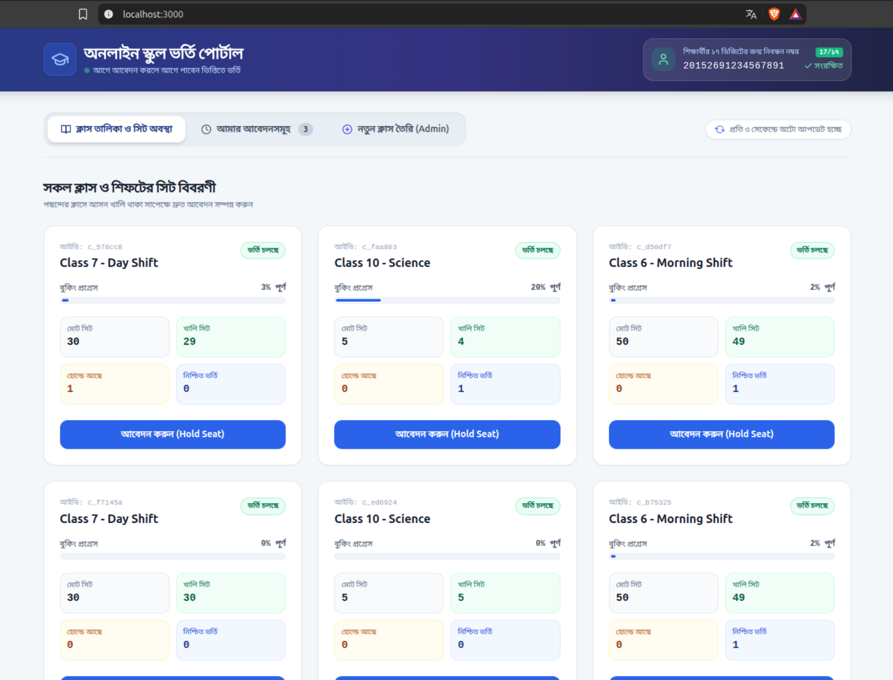
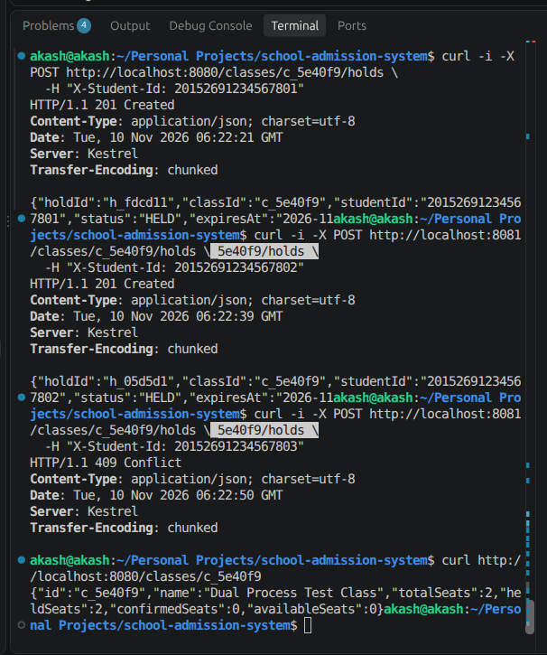
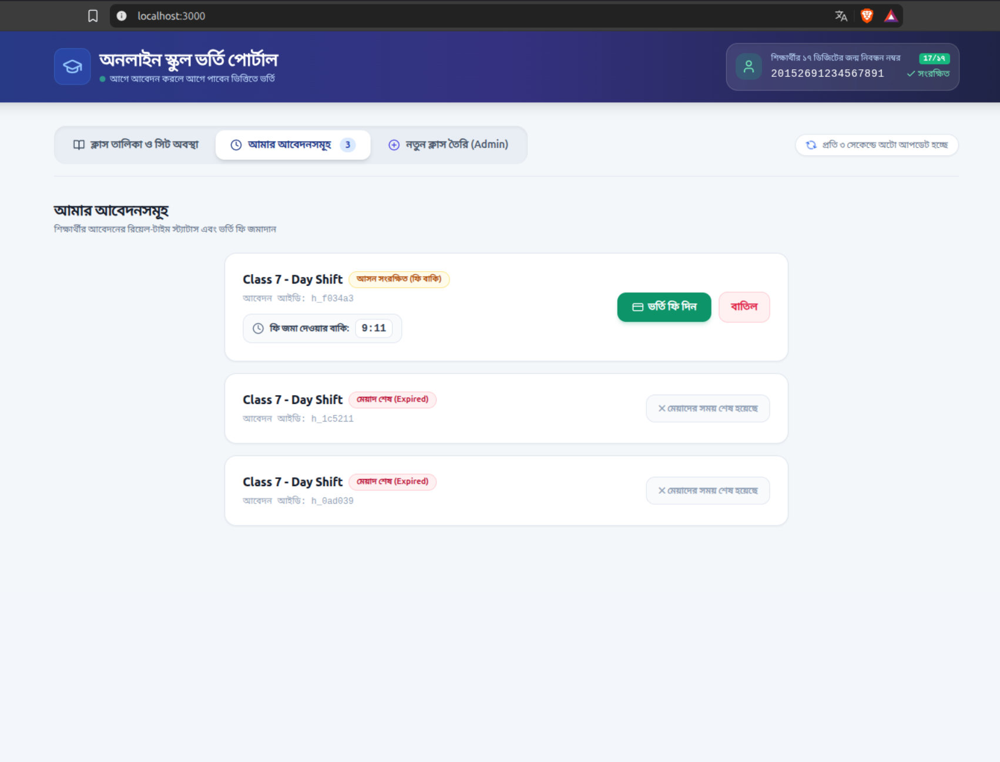
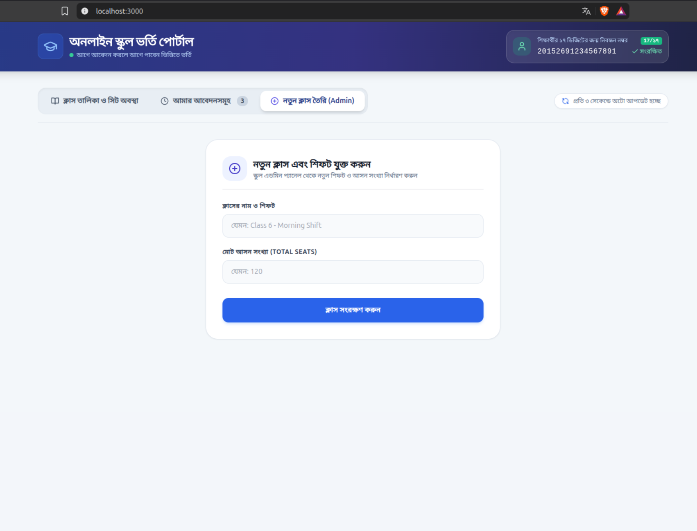
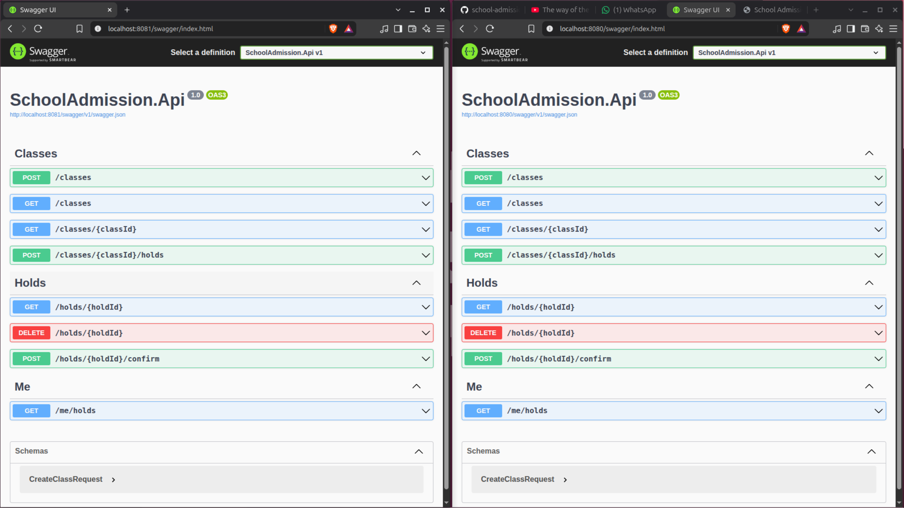
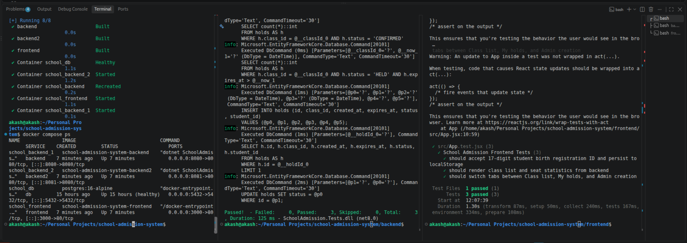
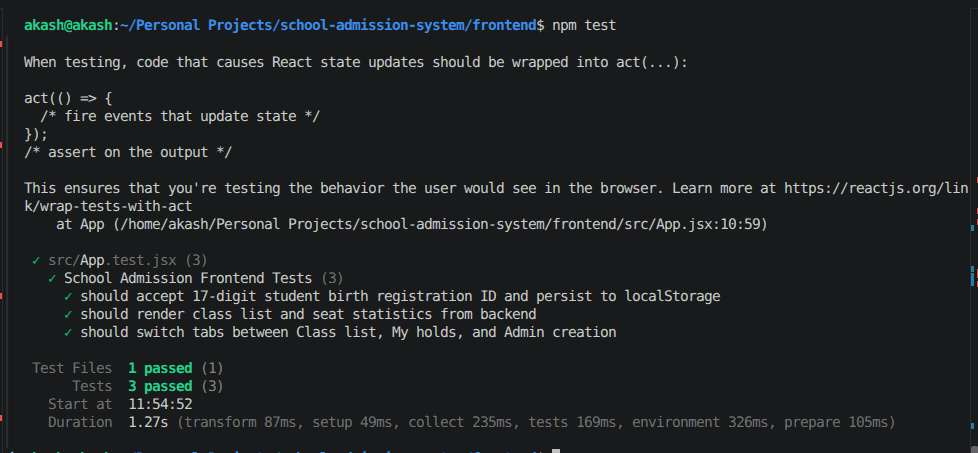

# Proof of Work & Visual Evidence

This document serves as visual verification that all system specifications, core features, and bonus requirements (§1.6) are implemented, tested, and operational.

---

## 1. Class List & Real-time Seat Overview
Shows the main admission dashboard with the 17-digit student birth registration number input at the top header, real-time auto-polling indicator, class list, and live breakdown of total, available, held, and confirmed seats.

---

## 2. Successful Seat Hold & Dynamic Seat Count Update
Demonstrates the user holding a seat. The available seat count decreases in real time, and a user-friendly notification confirms that the seat has been reserved pending admission fee payment.

---

## 3. Student Applications & Live Countdown Timer
Displays the "আমার আবেদনসমূহ" (My Applications) view for the student. It showcases the application ID, live countdown timer indicating remaining time before hold expiration, the "ভর্তি ফি দিন" (Pay Admission Fee) button, and the "বাতিল" (Cancel) button.

---

## 4. Admin Class Creation Panel
Shows the dedicated School Admin interface for creating new classes/shifts with specified total seat limits, which immediately persist and sync across all clients.

---

## 5. Dual Backend Processes Running in Docker
Verifies that Docker Compose spins up two separate backend processes running in isolated containers on different host ports:
- `school_backend_1` running on port **`8080`**
- `school_backend_2` running on port **`8081`**
Both connect to the shared PostgreSQL instance (`school_db`).

---

## 6. Multi-Process Concurrency Proof
Demonstrates live concurrency testing across both independent backend processes on ports `8080` and `8081`. Using PostgreSQL row-level pessimistic locking (`SELECT ... FOR UPDATE`), hold requests hitting different ports simultaneously are serialized, strictly preventing any over-allocation beyond `totalSeats`.

---

## 7. Frontend Automated Test Suite
Terminal output from **Vitest** and **React Testing Library** showing all 3 automated frontend tests passing:
1. 17-digit birth registration input & `localStorage` persistence.
2. Class list and seat statistics rendering.
3. Navigation and tab switching.

